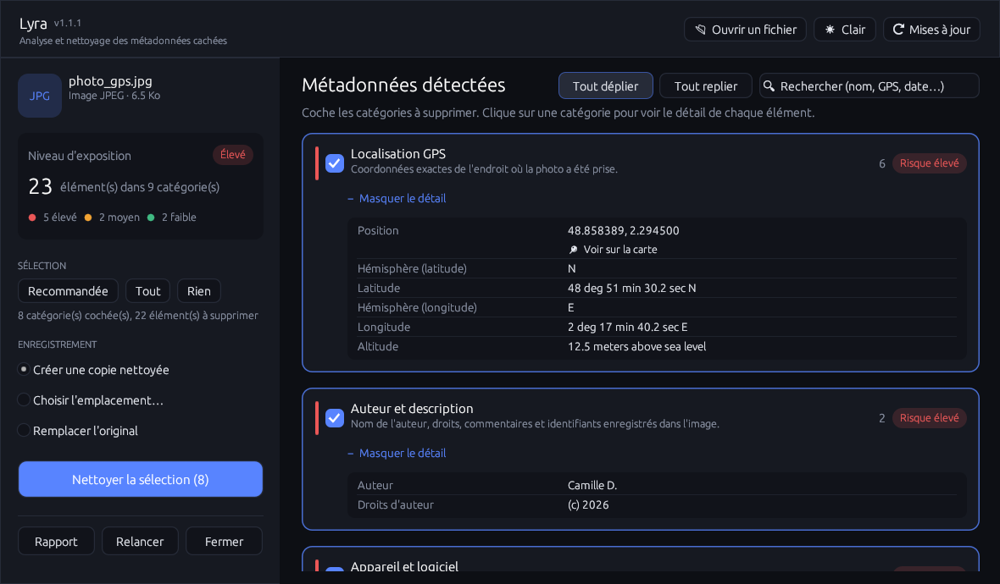

<p align="center"></p>

# OpenLyra

**Lyra** est un logiciel de bureau écrit en Rust pour **analyser** puis **supprimer** les métadonnées cachées d'un document. Tout se passe sur ton ordinateur : aucun document n'est envoyé sur Internet.



## Fonctionnalités

- **Glisser-déposer** ou sélection classique du fichier.
- **Rapport détaillé** : chaque catégorie de métadonnées est expliquée, classée par niveau de risque (élevé, moyen, faible) et dépliable pour voir chaque valeur. Pour les photos géolocalisées, un lien ouvre la position sur une carte.
- **Choix précis** de ce qu'il faut supprimer, catégorie par catégorie, avec trois raccourcis : *Recommandée*, *Tout*, *Rien*. La sélection recommandée retire tout ce qui est sensible sans toucher au rendu ni au contenu.
- **Recherche** dans le rapport (un nom, « GPS », une date…).
- **Enregistrement sûr** : par défaut une copie `nom_nettoye.ext` est créée et l'original reste intact. On peut aussi choisir l'emplacement ou remplacer l'original (avec confirmation).
- **Vérification automatique** : après le nettoyage, le nouveau fichier est réanalysé et le nombre d'éléments restants est affiché.
- **Export du rapport** en fichier texte.
- Thème sombre et thème clair.

## Formats et métadonnées pris en charge

| Format | Ce qui est détecté et supprimable |
|---|---|
| **JPEG** | EXIF détaillé (GPS, appareil, numéros de série, auteur, dates, réglages, miniature), XMP, IPTC/Photoshop, commentaires, blocs propriétaires, données cachées après l'image, profil ICC |
| **PNG** | Textes intégrés (auteur, logiciel, commentaires, paramètres de génération d'images IA…), EXIF, XMP, date de modification, blocs non standard, profil ICC |
| **PDF** | Auteur, titre/sujet/mots-clés, logiciels, dates, propriétés personnalisées, XMP du document et des images, annotations et leurs auteurs, identifiant du fichier. Les versions antérieures cachées (mises à jour incrémentales) sont toujours supprimées. |
| **Word, Excel, PowerPoint** (docx, xlsx, pptx…) | Auteurs, société, responsable, dates, titre, modèle (et son chemin), temps d'édition, nombre de révisions, propriétés personnalisées, miniature, imprimante, métadonnées des photos insérées. Pour Word : commentaires et suivi des modifications (accepté automatiquement). |
| **LibreOffice** (odt, ods, odp…) | Créateur, dernier auteur, imprimé par, dates, modèle, durée d'édition, propriétés personnalisées, miniature, imprimante, photos insérées, commentaires, suivi des modifications (texte). |

Le nettoyage EXIF est **sélectif** : on peut par exemple retirer le GPS et l'appareil tout en gardant l'orientation, pour que la photo ne pivote pas.

## Installation

### Télécharger Lyra (recommandé)

Va dans la section [**Releases**](https://github.com/Powerl3ss/OpenLyra/releases/latest) et télécharge `Lyra-windows.exe` (ou `Lyra-macos` / `Lyra-linux`). Aucun installateur : place le fichier où tu veux et lance-le.

Windows peut afficher « Windows a protégé votre ordinateur » car l'exécutable n'est pas signé : clique sur *Informations complémentaires* puis *Exécuter quand même*.

### Mises à jour automatiques

Au démarrage, Lyra vérifie s'il existe une version plus récente sur GitHub. Si c'est le cas, un bandeau propose de **mettre à jour** : la nouvelle version est téléchargée, son empreinte SHA-256 est vérifiée, puis l'exécutable est remplacé. Il suffit ensuite de cliquer sur **Redémarrer Lyra**. Le bouton *Mises à jour* en haut à droite permet aussi de vérifier à la main.

Lyra ne contacte Internet que pour cette vérification (API publique de GitHub). Tes documents ne quittent jamais ton ordinateur.

### Compiler soi-même (Windows, macOS ou Linux)

1. Installe Rust depuis <https://rustup.rs> (sous Windows, accepte l'installation des outils Visual Studio C++ proposée).
2. Ouvre un terminal dans ce dossier puis lance :

   ```
   cargo build --release
   ```

3. Le programme se trouve dans `target/release/` (`lyra.exe` sous Windows). Tu peux le copier où tu veux : c'est un seul fichier, sans installation.

Pour le lancer directement : `cargo run --release`.

## Publier une nouvelle version

Les mises à jour proposées dans Lyra viennent des **Releases** de ce dépôt. Pour en publier une :

**Depuis le site GitHub (le plus simple)**

1. Pousse tes modifications sur `main`.
2. Onglet **Actions** > **Publier une version** > **Run workflow**.
3. Indique le numéro (par exemple `1.1.0`, il doit être plus grand que le précédent) et, si tu veux, les nouveautés.

Le workflow met à jour `Cargo.toml`, crée le tag, compile Windows, macOS et Linux, calcule les empreintes SHA-256 et publie la release. Quelques minutes plus tard, tous les Lyra installés proposent la mise à jour.

**En changeant le numéro de version**

Modifie `version = "1.1.0"` dans `Cargo.toml` (même directement sur le site GitHub) et pousse sur `main`. Si cette version n'a pas encore de release, elle est publiée automatiquement. Les autres pushs sur `main` ne publient rien.

Le workflow `Vérification` compile et teste aussi le projet à chaque push sur `main`.

## Utilisation

1. Lance Lyra et glisse un fichier dans la fenêtre.
2. Lis le rapport, déplie les catégories pour voir les valeurs.
3. Coche ce que tu veux supprimer (la sélection recommandée est déjà cochée).
4. Clique sur **Nettoyer la sélection**.

Astuce : sous Windows, tu peux faire *clic droit > Ouvrir avec > Lyra* sur un fichier, il sera analysé dès l'ouverture.

### Ligne de commande (facultatif)

```
lyra analyze fichier.pdf
lyra clean fichier.pdf            # sélection recommandée
lyra clean fichier.pdf --all -o propre.pdf
lyra update                          # mise à jour depuis GitHub
lyra --version
```

Sous Windows, la version `--release` n'a pas de console : utilise `cargo run -- analyze fichier.pdf` pour voir la sortie.

## Limites connues

- Les PDF chiffrés ou protégés par mot de passe sont refusés (retire la protection avant).
- Les fichiers joints à l'intérieur d'un PDF ne sont pas nettoyés (un avertissement s'affiche).
- Pour Excel et PowerPoint, les commentaires sont signalés mais doivent être supprimés depuis l'application.
- Les métadonnées ne sont pas tout : le **contenu visible** (texte, en-têtes, noms dans le corps du document, visages sur une photo) n'est pas modifié.

## Structure du code

```
src/
├── main.rs          point d'entrée (interface ou ligne de commande)
├── gui.rs           interface egui
├── model.rs         rapport, catégories, niveaux de risque
├── xml.rs           lecture et filtrage XML en flux
├── exifmeta.rs      analyse et reconstruction sélective de l'EXIF
├── xmp.rs           lecture des paquets XMP
├── updater.rs       mises à jour depuis les releases GitHub
└── formats/
    ├── mod.rs       détection du format et aiguillage
    ├── jpeg.rs  png.rs  pdf.rs
    ├── zipdoc.rs    conteneur zip commun (Office / LibreOffice)
    ├── ooxml.rs     Word, Excel, PowerPoint
    └── odf.rs       LibreOffice
```

Le logo est dans `assets/` : `logo.svg` (fond sombre), `logo-clair.svg`, `logo-seul.svg` (sans fond), `lyra.ico` (icône de l'exe, intégrée par `build.rs`) et `icon-256.png` (icône de la fenêtre).

Bibliothèques principales : `eframe`/`egui` (interface), `rfd` (boîtes de dialogue natives), `lopdf` (PDF), `kamadak-exif` (EXIF), `quick-xml`, `zip`.
